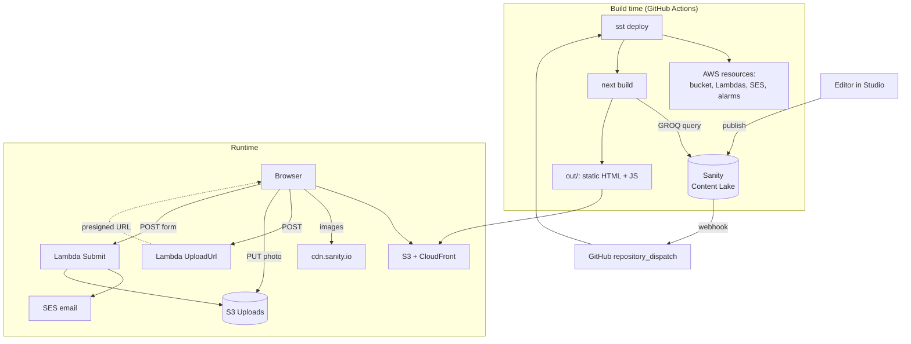

# Lesson 0: The big picture

**Why:** the three technologies meet at very specific points. Knowing *when* each one runs (on your laptop, in CI at
build time, in the browser, or in a Lambda) makes the rest of the guide much easier.

## Four places code runs

| Where | When | What runs | Technology |
|---|---|---|---|
| **GitHub Actions** (or your laptop) | On deploy | `sst deploy`: creates AWS resources, then runs `next build`, which **fetches all content from Sanity** and writes plain HTML/JS to `out/` | SST, Next.js, Sanity client |
| **S3 + CloudFront** | Every page view | Nothing: it only serves the files from `out/` | SST `StaticSite` |
| **The browser** | Every page view | React hydrates a few interactive parts (form, menu, gallery, analytics) | Next.js client components |
| **Two Lambdas** | Form use | `UploadUrl` (presigned S3 upload) and `Submit` (validation, spam checks, email via SES) | SST `Function` |

Two more systems sit outside AWS:

- **Sanity** hosts the content (the *Content Lake*) and the editing app (the *Studio*, at `<name>.sanity.studio`).
  The site only talks to it **at build time**, plus `cdn.sanity.io` for images in the browser.
- **Cloudflare** holds the DNS for `piotrpieprzyk.com`. SST writes the records there.



## Trace 1: an editor changes the phone number

1. The editor changes *Telefon* in the Studio and presses **Publish**. Sanity stores the new version of the
   `siteSettings` document (lessons 4, 5).
2. A Sanity **webhook** fires and calls GitHub's API with `{"event_type": "sanity-publish"}` (lesson 8).
3. GitHub Actions starts [`deploy.yml`](../.github/workflows/deploy.yml), which runs `npx sst deploy --stage production`
   (lesson 14).
4. SST checks the AWS resources (no changes), then builds the site: `next build` calls `getContent()`, which runs one
   GROQ query and merges the result over `seed.json` (lesson 6).
5. Every `{telefon}` token in the copy is replaced with the new number, and every `tel:` link is rebuilt, **at build
   time** (lessons 2, 6).
6. SST uploads `out/` to S3 and invalidates CloudFront. About 2–3 minutes after the click, the site shows the new
   number.

Nothing on the live site asks Sanity for text. That's the key design decision (lesson 2).

## Trace 2: a visitor sends the quote form with two photos

1. The page's JavaScript bundle already contains the two Lambda URLs. They were inlined as `NEXT_PUBLIC_*` variables
   at build time (lessons 3, 10).
2. For each photo: the browser compresses it, POSTs `{name, type, size}` to **UploadUrl**, receives a presigned S3 URL,
   and PUTs the file **straight to S3** with a progress bar (lessons 3, 12).
3. On submit, the browser POSTs the fields plus the S3 keys of the photos to **Submit**.
4. Submit validates the payload (zod), drops bots (honeypot, timing, Turnstile), reads the photos from S3, and sends
   one raw MIME email through SES with the photos attached and signed links as a backup (lesson 12).
5. Any Lambda error triggers a CloudWatch alarm → SNS → an email to the owner (lesson 14).

## Learn

- [`PLAN.md`](../PLAN.md): the original architecture plan, including the cost estimate. Read the "Key decisions" part
  now; the rest of the guide explains how each decision became code.
- [`README.md`](../README.md): day-to-day commands and the first-time setup order.
- [`docs/conventions.md`](../docs/conventions.md): the rules the code follows.

## Read in the repo

Skim the top level: `src/` (the Next.js site), `studio/` (a separate Sanity Studio app with its own
`package.json`), `functions/` (the two Lambdas), `sst.config.ts` (all infrastructure), `scripts/` (setup helpers), and
`.github/workflows/` (CI).

## Do

Run the site with no cloud at all:

```
npm install
npm run dev        # http://localhost:3000
```

Without `SANITY_PROJECT_ID` in `.env`, the copy comes from `src/content/seed.json`. The form renders, but sending fails,
because no Lambda URL was injected. You'll see why in lessons 3 and 13.

## Check yourself

- Name the one moment when the site reads text from Sanity. What happens to the live site if Sanity is down?
- Photos never pass through a Lambda on the way *in*. Why might that matter? (Hint: Lambda payload limits, lesson 12.)
- Which of the four places needs AWS credentials, and which gets them how? (You'll answer fully in lesson 14.)

---

Next: [Lesson 1: App Router basics](01-nextjs-app-router.md)
