# Learning guide: how this project works

This guide takes you from "SST, Sanity and Next.js are new to me" to understanding every file in this repo. It
assumes you're an experienced developer: it skips JavaScript, React, TypeScript and general AWS basics, and spends
its time on what's new and on the decisions that aren't obvious from the code alone. If you did the Terraform guide
in `tic-tac-toe/aws/learning`, the SST lessons build on it.

Every lesson has the same parts:

- **Why**: where the topic shows up in this project.
- **Learn**: the concepts, with links to the official docs.
- **Read in the repo**: the files to read once the concepts make sense.
- **Do**: something to run. The cost is noted when it isn't zero.
- **Check yourself**: questions to answer before moving on.

Lessons 0–8 and [lab 01](examples/01-groq-playground/query.mjs) need no cloud account. Lessons 9–14 are best done
with the AWS profile from the [main README](../README.md#aws-credentials); [lab 02](examples/02-sst-hello/sst.config.ts)
deploys a tiny app to your own stage for ~$0.

```mermaid
flowchart LR
    L0[0. Big picture] --> N1

    subgraph Next.js
        N1[1. App Router] --> N2[2. Static export] --> N3[3. Client islands]
    end

    subgraph Sanity
        S4[4. Mental model] --> S5[5. Schemas] --> S6[6. GROQ + fetching] --> S7[7. Images] --> S8[8. Content pipeline]
    end

    subgraph SST
        T9[9. Mental model] --> T10[10. Components + linking] --> T11[11. Secrets + config]
        T11 --> T12[12. Backend functions] --> T13[13. Dev + stages] --> T14[14. Deploy + CI]
    end

    N3 --> S4
    S8 --> T9
    T14 --> B15[15. Best practices] --> B16[16. Next steps]
```

| # | Lesson | Area |
|---|---|---|
| 0 | [The big picture](00-big-picture.md) | all |
| 1 | [App Router basics](01-nextjs-app-router.md) | Next.js |
| 2 | [Static export](02-nextjs-static-export.md) | Next.js |
| 3 | [Client islands and the browser side](03-nextjs-client-islands.md) | Next.js |
| 4 | [Sanity mental model](04-sanity-mental-model.md) | Sanity |
| 5 | [Schemas and the Studio](05-sanity-schemas.md) | Sanity |
| 6 | [GROQ and fetching content](06-groq-and-fetching.md) | Sanity |
| 7 | [Images](07-sanity-images.md) | Sanity |
| 8 | [The content pipeline: publish → rebuild](08-content-pipeline.md) | Sanity + CI |
| 9 | [SST mental model](09-sst-mental-model.md) | SST |
| 10 | [Components, linking and outputs](10-sst-components-linking.md) | SST |
| 11 | [Secrets and configuration](11-sst-secrets-config.md) | SST |
| 12 | [The backend functions](12-backend-functions.md) | SST + AWS |
| 13 | [Local dev and stages](13-sst-dev-and-stages.md) | SST |
| 14 | [Deploy, CI and monitoring](14-deploy-and-ci.md) | SST + CI |
| 15 | [Best practices, and where this repo applies them](15-best-practices.md) | all |
| 16 | [Where to go next](16-next-steps.md) | all |

**Useful everywhere:**

| Resource | What for |
|---|---|
| [Next.js docs (App Router)](https://nextjs.org/docs/app/getting-started/project-structure) | File conventions, components, config |
| [Next.js: static exports](https://nextjs.org/docs/app/guides/static-exports) | What `output: "export"` allows and forbids |
| [Sanity docs](https://www.sanity.io/docs) | Studio, schemas, Content Lake, CLI |
| [GROQ reference](https://www.sanity.io/docs/groq) | The query language |
| [SST docs](https://sst.dev/docs/) | Components, linking, CLI |
| [SST components list](https://sst.dev/docs/components/) | Every `sst.aws.*` component and its options |
| [Pulumi AWS provider](https://www.pulumi.com/registry/packages/aws/) | The raw `aws.*` resources used next to SST components |
| `npx sst <command> --help` | CLI help |
| `cd studio && npx sanity help` | Sanity CLI help |

---

## Quick map: file → lesson

| File | Lessons |
|---|---|
| [`next.config.ts`](../next.config.ts) | 2, 3, 7 |
| [`src/app/layout.tsx`](../src/app/layout.tsx), [`page.tsx`](../src/app/page.tsx) | 1, 2 |
| [`src/app/polityka-prywatnosci/page.tsx`](../src/app/polityka-prywatnosci/page.tsx), [`not-found.tsx`](../src/app/not-found.tsx) | 1, 2 |
| [`src/components/sections/*`](../src/components/sections) | 1, 3 |
| [`src/components/sections/QuoteForm.tsx`](../src/components/sections/QuoteForm.tsx), [`src/lib/upload.ts`](../src/lib/upload.ts) | 3, 12 |
| [`src/components/Analytics.tsx`](../src/components/Analytics.tsx), [`src/lib/analytics.ts`](../src/lib/analytics.ts) | 3 |
| [`src/content/types.ts`](../src/content/types.ts), [`seed.json`](../src/content/seed.json), [`tokens.ts`](../src/content/tokens.ts) | 5, 6 |
| [`src/content/query.ts`](../src/content/query.ts), [`fetch.ts`](../src/content/fetch.ts) | 6 |
| [`src/lib/sanity-image.ts`](../src/lib/sanity-image.ts), [`sanity-image-loader.ts`](../src/lib/sanity-image-loader.ts), [`src/components/ui/Photo.tsx`](../src/components/ui/Photo.tsx) | 7 |
| [`studio/sanity.config.ts`](../studio/sanity.config.ts), [`sanity.cli.ts`](../studio/sanity.cli.ts) | 4, 5 |
| [`studio/schemas/`](../studio/schemas) | 5 |
| [`studio/scripts/build-seed.mjs`](../studio/scripts/build-seed.mjs), [`scripts/setup-sanity.mjs`](../scripts/setup-sanity.mjs) | 8 |
| [`sst.config.ts`](../sst.config.ts) | 9, 10, 11, 13, 14 |
| [`sst-env.d.ts`](../sst-env.d.ts) | 10 |
| [`scripts/sst.mjs`](../scripts/sst.mjs), [`load-env.mjs`](../scripts/load-env.mjs) | 11 |
| [`functions/`](../functions) | 12 |
| [`.github/workflows/deploy.yml`](../.github/workflows/deploy.yml), [`scripts/setup-github.mjs`](../scripts/setup-github.mjs) | 8, 14 |
| [`examples/01-groq-playground`](examples/01-groq-playground/query.mjs) | 6 |
| [`examples/02-sst-hello`](examples/02-sst-hello/sst.config.ts) | 9, 10, 11, 13 |
